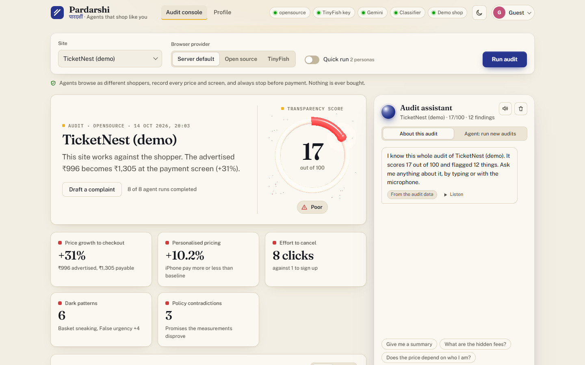
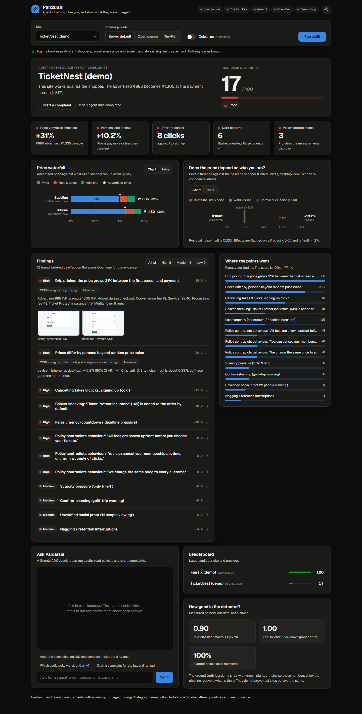
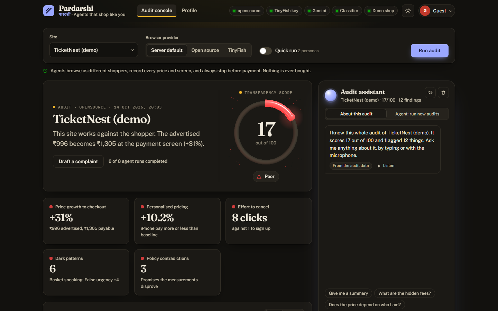
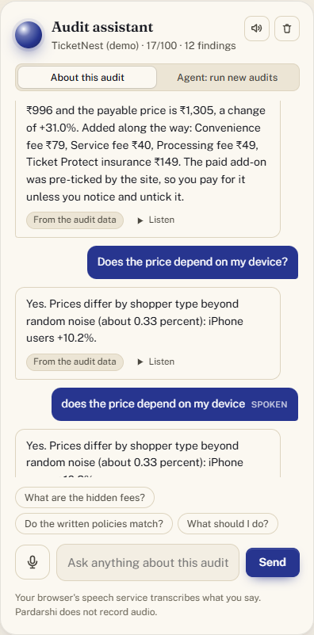
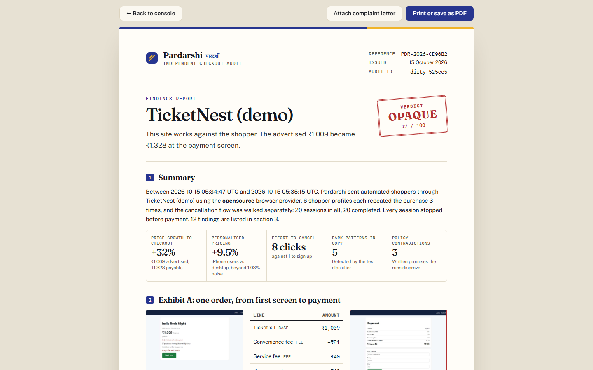
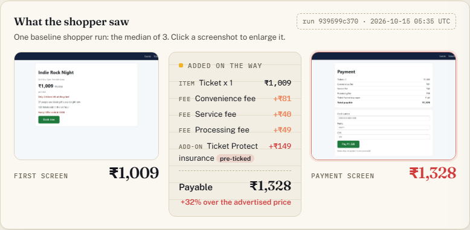
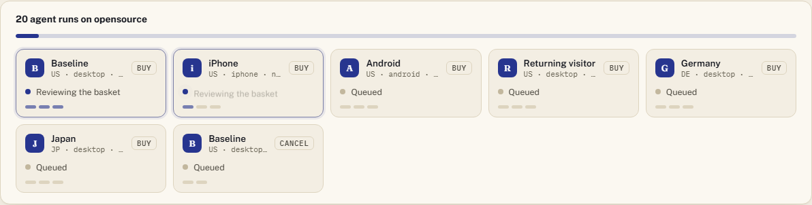
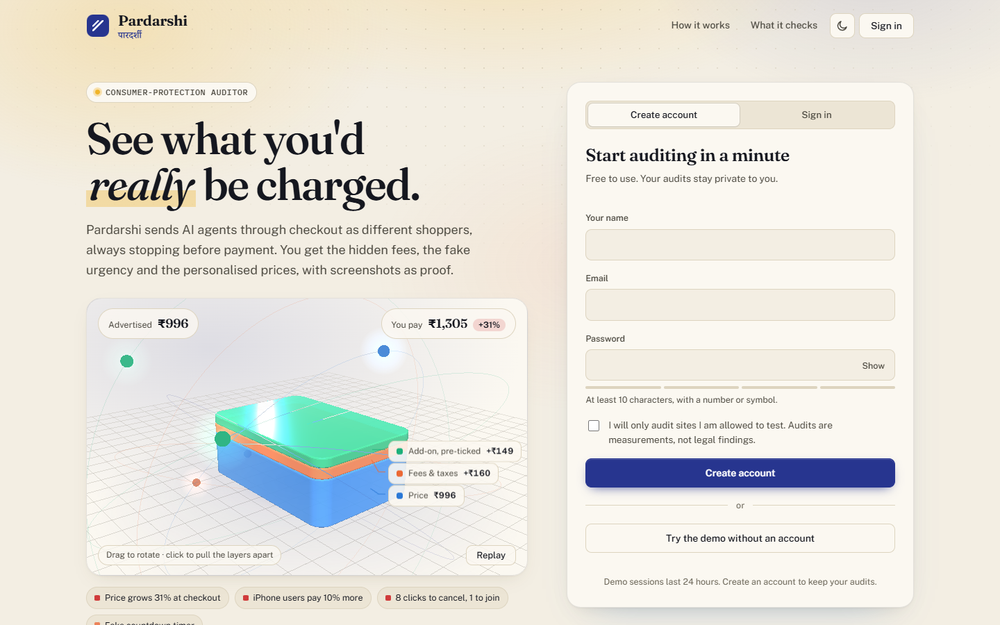

<p align="center"></p>

# Pardarshi

**Agents that shop like you, and show what they were charged.** Built for AZINHACK '26 by team **RED-HAT**.

Most "dark pattern" tools read one page. Pardarshi sends AI agents through the **whole** booking, checkout and cancellation flow as *different shoppers* (country, device, new vs returning), always **stopping before payment**, and then uses ML and statistics to report:

<p align="center">
  <a href="https://youtu.be/SyPbXZ6AQbQ">
    
  </a>
</p>

| Check | How it is measured |
|---|---|
| **Drip pricing** | Advertised price vs payable price, with every fee itemised (price waterfall) |
| **Basket sneaking** | Pre-ticked paid add-ons that are included in the total |
| **Dark-pattern copy** | Text classifier: false urgency, scarcity, fake social proof, confirm-shaming, forced action, subscription trap, nagging |
| **Fake deadlines** | A countdown is run, the page is reloaded, and a timer that resets proves the deadline is invented |
| **Personalised pricing** | Regression on log-price across personas; flagged only if it beats the site's own noise |
| **Cancellation friction** | Clicks and screens to cancel vs to sign up |
| **Policy vs reality** | Terms and refund pages are read and each promise is checked against what was measured |

The output is a transparency score, a price waterfall, screenshot evidence for every finding, and a one-click **draft complaint** for India's National Consumer Helpline, mapped to the CCPA 2023 dark-pattern categories.



<details><summary>Dark theme</summary>



</details>

The dashboard follows the OS theme (with a manual toggle), draws every chart as hand-built SVG with hover tooltips and a table view for each, and works down to phone width.

---

## 3D visuals and the audit assistant



* **Drip pricing in 3D** (landing page): a real WebGL scene, not a video. A price slab is joined by a fees slab and a pre-ticked add-on slab while the "You pay" counter climbs from ₹996 to ₹1,305; agent orbs circle the stack. Drag to rotate, hover a layer to highlight it, click to pull the layers apart. The labels track the slabs.
* **Score ring** (console): a 3D gauge that fills to the audit's transparency score, coloured by its status.
* Built on a locally vendored Three.js (no CDN, so it works offline and under the strict CSP). It pauses when off-screen, shows still frames under `prefers-reduced-motion`, and falls back to a static preview if WebGL is missing. If WebGL is running in **software** (no GPU), it starts in a lighter mode (no anti-aliasing, 1x resolution, 30 fps, no backdrop blur) instead of freezing the page.



**Audit assistant** (docked beside the report). It knows the whole audit: score, every finding, the price lines for each shopper, the personalization statistics and the cancellation flow.

| | |
|---|---|
| **Ask** | Type, or tap the microphone and speak. Answers can be read aloud (the speaker button turns it on for every answer, and a question asked by voice is always answered by voice). Each answer also has a Listen button. |
| **Engines** | Short questions about a known topic (score, hidden fees, device or country pricing, cancelling, policies, dark patterns, what to do, how the score works) are answered **exactly and instantly from the audit's own numbers**, with no API call. Longer or open-ended questions go to Gemini with the whole audit as context and a rule to answer only from it. If Gemini is busy or out of quota, the exact engine answers instead. Each answer says which engine wrote it. |
| **Honesty** | It says "not tested in this audit" when asked about a shopper type the audit did not include, and "I could not find that in this audit" instead of guessing. |
| **Agent mode** | A switch changes it to the Google ADK agent, which can run new audits, compare sites and draft complaints. |
| **Voice** | Uses the browser's built-in speech recognition and speech synthesis (Chrome, Edge and Safari). The browser's speech service transcribes the audio; Pardarshi never records or stores it. Typing works in every browser. |

## Evidence, the findings report and live agents



A sample PDF made with the browser's "Save as PDF" is in [docs/sample-report.pdf](docs/sample-report.pdf). The console's evidence strip looks like this:



* **Findings report** (`/report?audit=…`, "Findings report" button on the console). A document built for printing or "Save as PDF": a reference number (`PDR-2026-XXXXXX`), the verdict stamp, a summary, **Exhibit A** (first screen and payment screen side by side, with every line that was added), the findings table with CCPA categories and exhibit numbers (E-1, E-2…), the method, the limitations, every screenshot as a numbered exhibit, and an **integrity** section. A complaint letter for the National Consumer Helpline can be attached as an annex.
* **Integrity.** The report lists a SHA-256 for the report data and every exhibit, plus one fingerprint over all of them (`GET /api/audits/{id}/dossier`). Changing any stored screenshot changes the fingerprint, so a printed copy can be checked against the files later. This shows tampering after the fact; it is not a signature from a trusted third party.
* **What the shopper saw** (console). The same before and after evidence as a strip: the first screen, a receipt of what was added on the way (pre-ticked add-ons marked), and the payment screen. Click a screenshot to enlarge it.
* **Live agents.** While an audit runs, each shopper profile gets a card that shows the step its agent is on as it happens ("Reading the product page", "Reviewing the basket", "At payment, not paying"), one pip per repeat, and the price it reached. The pipeline sends these as `step` events over the same SSE stream.



## Accounts, onboarding and profile



* **Onboarding** (`/`): create an account or sign in, then a short wizard stores your country, what you check, the name used on complaints, and your console defaults (provider, quick runs, theme). **Try the demo** starts a 24-hour guest session; if a guest creates an account, their audits move with them.
* **Profile** (`/profile`): account details, complaint defaults, preferences, password change, a list of signed-in devices you can revoke, audit history (open or delete), and account deletion.
* **Console** (`/app`) and every API route except `/api/auth/*` and `/api/health` need a signed-in session.

| Concern | What is implemented |
|---|---|
| Passwords | scrypt with a per-user salt; 10+ characters, rejects common passwords and your own email name; a dummy hash is checked for unknown emails so login timing does not reveal who has an account |
| Sessions | Random 256-bit token in an `HttpOnly`, `SameSite=Lax` cookie (`Secure` over HTTPS); only its SHA-256 is stored; individually revocable; changing the password signs out other devices |
| CSRF | `SameSite=Lax`, a required `X-Requested-With` header and an `Origin` check on every unsafe request |
| Abuse | Sliding-window limits on sign-in (per account and per IP), sign-up, password and delete attempts, audit starts (credit protection) and chat messages (quota protection) |
| Privacy | Each audit has an owner. Reports, screenshots (`/files/...`), the SSE stream and the ADK agent's tools all check ownership. Another user's audit returns 404, not 403 |
| Headers | CSP (`script-src 'self'`), `X-Frame-Options: DENY`, `nosniff`, `Referrer-Policy`, `Cache-Control: no-store` on pages and API |

Not built, on purpose: there is **no email service**, so no email verification and no emailed reset link. An operator resets a password with `python -m scripts.manage_users reset <email>`. Rate-limit counters live in memory (they reset on restart; fine for one server, use Redis for several). Serve over HTTPS in production so the session cookie is marked `Secure`. Audits that existed before accounts were added have no owner and are shown to everyone as shared samples.

## How TinyFish is used

TinyFish is the part that makes the audit **real** instead of simulated. All four APIs have a job ([app/providers/tinyfish.py](app/providers/tinyfish.py)):

| API | Used for | Why a plain scraper cannot do it |
|---|---|---|
| **Browser API** | Cloud browser per persona over CDP/Playwright, with a **country proxy** (US, GB, DE, JP, ...). Device, locale and timezone are emulated; the countdown/reload probe, screenshots and DOM capture run on it. | Personalised pricing is only visible from a real IP in another country. |
| **Agent API** | Goal-driven multi-step walk of sites we have no script for. A typed `output_schema` returns every price line and the verbatim UI copy per page, which our classifier then judges. | Checkout flows differ on every site and change often. |
| **Fetch API** | Terms, refund and cancellation pages as clean text for the policy-vs-reality check. | JS-heavy policy pages, PDFs. |
| **Search API** | Peer-site discovery and public complaint threads (exposed to the ADK agent). | Fresh web results. |

`PROVIDER=tinyfish` selects it; `PROVIDER=opensource` swaps in local Playwright + httpx + DuckDuckGo behind the **same interfaces** ([app/providers/base.py](app/providers/base.py)), which is how development and tests ran without spending credits.

## Architecture

```
Dashboard (web/)  <-- REST + SSE -->  FastAPI (app/main.py)
                                         |
                        Google ADK  root agent "pardarshi"  (app/agents/orchestrator.py)
                        |- tools: run_audit, get_audit, list_audits, find_peer_sites
                        |- sub-agent policy_analyst   (Fetch)
                        '- sub-agent complaint_writer (Gemini)
                                         |
              Pipeline (app/pipeline.py): personas x repeats, run in parallel
                                         |
        Provider layer  TinyFish (Browser | Agent | Fetch | Search)   <->   Open source (Playwright | httpx | DDG)
                                         |
        Capture schema (app/capture)  ->  ML + stats (app/ml, app/analysis.py)  ->  AuditReport
```

## The ML, in detail

* **Text classifier** ([app/ml/pattern_clf.py](app/ml/pattern_clf.py)): TF-IDF (word + char n-grams) with logistic regression. It trains in seconds on a laptop CPU, and the top n-grams per class are inspectable. It deliberately ignores the element role (link/heading), because an earlier version used it as a shortcut and flagged site navigation as "dark patterns" (found by testing on the clean shop; see the history below).
* **Price extractor** ([app/ml/price_extract.py](app/ml/price_extract.py)): rule-based parsing of labelled price rows into a waterfall (base, fee, tax, add-on, discount, total).
* **Personalization test** ([app/ml/personalization.py](app/ml/personalization.py)): one-factor-at-a-time persona design, OLS on log-price, repeats give the residual noise, Benjamini-Hochberg correction, a minimum-effect floor. Pure noise is flagged in under 8% of 200 simulated audits (unit-tested).
* **Score:** `100 * exp(-penalty/70)`; every finding's penalty is shown, so the number is explainable.

## Measured results (not claimed)

| What | Result | Honest caveat |
|---|---|---|
| Text classifier, human-written held-out set (n=78) | macro-F1 **0.90**, dark-vs-normal F1 **0.93** | Trained on templates plus seed rows we wrote; the held-out set is ours too, so the web will be harder. A Gemini zero-shot comparison is one command: `python -m scripts.eval_llm_baseline` |
| End-to-end on the demo shop with **known injected tricks** (`python -m eval.evaluate`) | precision **1.0**, recall **1.0** over pattern classes, drip, personalization and friction; clean shop scores 100, no false positives | The ground truth is a shop we built. It proves the pipeline recovers what is there, not that real sites behave the same. |
| Price bias recovery (injected +10% iPhone, +6% DE, +4% returning) | measured +10.2%, +6.0%, +4.4%; Android and JP correctly ~0 | Same caveat. |
| Policy check | all 3 planted policy contradictions found | Needs a Gemini request; free-tier quota is 20/day/model. |

### What went wrong on the way (kept for the record)
The first end-to-end run gave the **clean** shop a score of 70: the classifier had learned that "links are confirm-shaming" and "headings are nagging", flagging nav items like "Events". Fixes: removed the role feature, added hundreds of neutral UI strings as negatives, and ignored 1-2 word strings. The clean shop now scores 100.

## Run it

```powershell
python -m venv .venv ; .\.venv\Scripts\activate
pip install -r requirements.txt ; playwright install chromium
copy .env.example .env      # add GEMINI_API_KEY (and TINYFISH_API_KEY for the TinyFish provider)
python -m app.ml.pattern_clf                 # trains the classifier, prints held-out metrics
.\scripts\start.ps1                          # demo shop :8100 + dashboard :8000
python -m pytest -q                          # 94 tests (ML, browser flows, walls and guards, TinyFish mapping, auth, sessions, assistant, report integrity)
python -m eval.evaluate --repeats 3          # scores the pipeline against ground truth
```

### Using TinyFish (final test / demo)
1. `python -m scripts.tinyfish_smoke` checks Search and Fetch (free). Add `--browser` / `--agent` to test those too; the wallet balance is printed before and after so you see the cost per call.
2. TinyFish's cloud browsers must reach the demo shop, so expose it publicly, e.g. `cloudflared tunnel --url http://127.0.0.1:8100`. Country is read from the `CF-IPCountry` header the tunnel adds.
3. In `.env`: `PROVIDER=tinyfish`, `DEMO_SHOP_URL=https://<your-tunnel>`, and add the tunnel's host to `ALLOWED_HOSTS`.
4. In the dashboard choose "TinyFish" as the provider, or run `python -m eval.evaluate`.

For a real site: add its host to `ALLOWED_HOSTS` and audit it with the Agent API lane (`TINYFISH_LANE=agent`).

## Ethics and safety
* **Never pays.** Goals forbid it, and a hard guard stops the run when a card form appears. Nothing is ever typed into payment fields.
* **No logins, no personal data**, read-only, small request volume, and an **allowlist** of hosts that may be audited.
* Findings are measurements with evidence, not legal accusations. CCPA category names are indicative, to help a shopper describe what they saw.

## Real sites: login walls, bot walls and your own account

Most big shops (Flipkart, Bewakoof and similar) ask for a login or an OTP before payment, and Pardarshi never
types personal data. So on real sites an agent run ends in one of these ways, and the report says which:

| Ends at | What it means | Counted? |
|---|---|---|
| **Payment** | A card form or a payment-method screen (UPI, net banking, card, cash on delivery...) | Yes |
| **Checkout summary** | A login or personal-details step came next, but the site had already shown a checkout total (for example the cart's price details). That total is the payable price, and the report notes that charges added later are not covered. | Yes |
| **Login wall** | A login came before any total was shown | No |
| **Blocked** | A CAPTCHA or access-denied page. Reported, **never bypassed**. | No |

If no run is counted, the audit ends with the reason instead of a score: a site Pardarshi could not measure never shows as 100/100.
The console then shows a card with the reason, the last page each shopper saw (for example the block page) as evidence,
and what to try next.

**Polite mode (always on for real sites).** Shoppers run one at a time, never as a burst of parallel sessions, with a
human-like pause of 1.5 to 4 seconds between actions (`POLITE_MIN_DELAY`, `POLITE_MAX_DELAY`). The demo shops still run
in parallel.

**Same product for every shopper.** On a site without a script, the baseline shopper's first run picks a product; every
other shopper then starts on that exact product page, so prices are compared like for like (listings differ by device
and visitor, so "the first product" could otherwise be a different item). Each run records the product it priced (the
page's main heading and link). The console shows "Product checked: … same product in all N runs", the agent cards and
the findings report name it, and any run that still priced a different product is left out of the price comparisons
with a note. The assistant answers "Which product did you check?".

**Hard guards, in code, whatever the model decides.** The agent refuses to click anything that would pay, confirm an
order or start a subscription ("Pay ₹…", "Proceed to pay", "Confirm order", "Subscribe"...), and it never types into
card, password, OTP, phone, email, name or address fields.

**Indian shoppers on real sites.** A real site audited from this machine is seen from India, so the shopper's
language and timezone say so too (`en-IN`, `Asia/Kolkata`; set by `HOME_COUNTRY`, default `IN`). The demo shop keeps
its US / Germany / Japan matrix. TinyFish has no India exit, so TinyFish runs stay labelled US rather than claim India.

**Your own account (behind the login).** In the console choose "Another site", type the site and click
**Connect account**. Your installed Chrome (or Edge) opens on the site as an ordinary window; sign in yourself
(password, OTP), then click **Save sign-in**. Nothing drives that window while you sign in. The same works from a
terminal:

```bash
python -m scripts.connect_account you@example.com www.example-shop.com   # a browser opens: sign in yourself, then press Enter
```

Pardarshi saves only that browser's cookies, under your Pardarshi account (`<data dir>/sessions/<user>/`), and never
uses them for anyone else. In the console choose "Another site", tick **Use my signed-in session**, and run. These
audits run on the open-source provider only (the sign-in never leaves the machine), with one shopper and one run (a
signed-in account has one shared cart), and the report says so. Remove a session from the same dialog or with
`--forget`; deleting your Pardarshi account deletes them too. Treat a saved session like a password.

**Indian sites we dry-ran (16 Oct 2026, one shopper, open-source lane).** Bot walls are reported, never bypassed.

| Site | Result |
|---|---|
| bummer.in | Reached the payment page (₹599) in about 2 minutes |
| fardaclothing.com | Reached the payment page (₹6,999) in under a minute |
| decathlon.in | Checkout summary before the login (MRP ₹299, total ₹129) |
| vahdam.in, suta.in, lenskart.com | Reach checkout; re-test after the latest fixes |
| thesouledstore.com | Login before any total: use Connect account |
| boat-lifestyle.com | Cart offers only "Pay Now", which the guard never clicks |
| Myntra, Meesho, Ajio, Nykaa, MakeMyTrip, BookMyShow, BigBasket, Croma | Block automated browsers at the door |

Big platforms' terms usually forbid automated access. Audit sites you are allowed to test, keep results about named
companies private until you have checked every exhibit, and use your own account rather than anyone else's.

## Known limitations
* TinyFish proxies cover US, GB, CA, DE, FR, JP, AU. **India is not available**, so geo-pricing tests use those countries; the India angle is the law and the complaint flow.
* The TinyFish provider's request/response mapping follows the SDK types and is unit-tested offline; the live check is `scripts/tinyfish_smoke.py`.
* Real sites may block bots or change flows (blocked runs are reported, never bypassed); the demo shop plus cached audits (`samples/`) keep the demo reproducible.
* On sites that need a login before payment, charges added after the login are only covered with your own connected account.
* Free-tier Gemini quotas are tight (about 20 requests per model per day); the LLM helper rotates across models.

## Layout
`app/` backend, auth, ML and providers - `demo_shop/` ground-truth shop - `web/` onboarding, console and profile pages - `eval/` ground-truth scoring - `scripts/` data, smoke tests, helpers - `samples/` a real dirty and clean audit with screenshots - `tests/`
